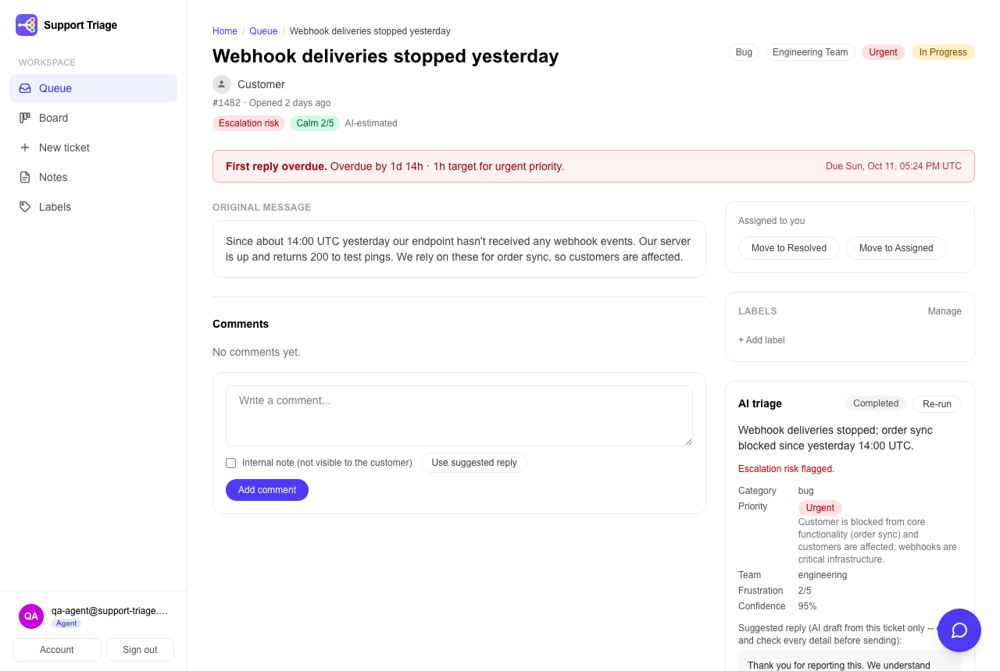
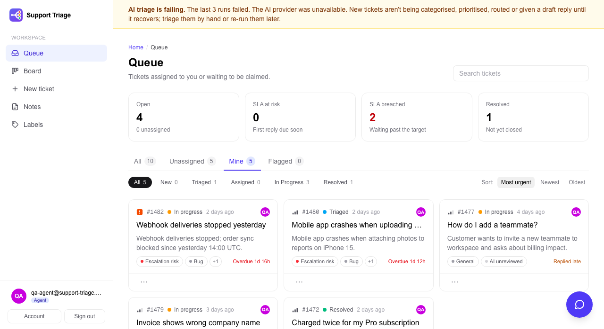
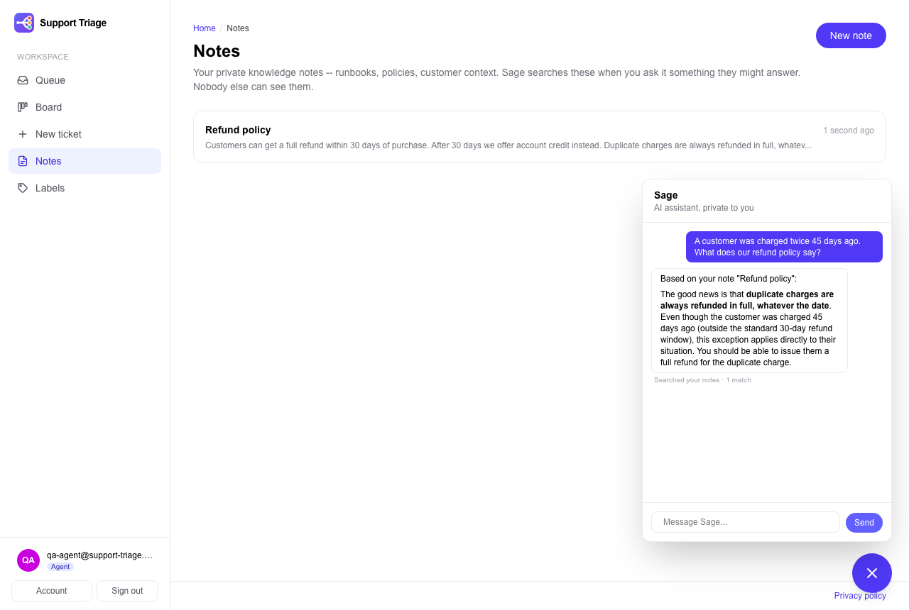

# Support Ticket Triage

A support ticketing app -- customers file tickets, agents work a queue, admins run the team --
built around an **AI triage agent**. Every new ticket is assessed by an LLM the moment it's
filed, so an agent opening the queue already knows what each ticket is about, how urgent it is
and why, which team should own it, whether it's a repeat of something already open, and how they
might start replying.

**Live:** https://support-triage-app-one.vercel.app (requires sign-in; open it in an incognito
window and you land on the login page, never on data).



## Why the AI feature is the core, not a bolt-on

Without triage this is a plain CRUD ticket form -- a queue of subjects sorted by date. The value
of the product is that a human never has to read a ticket cold:

- **Category, priority and a stated reason.** Not just "high" but *"paying customer reports a
  duplicate charge with the order number provided; clear financial impact"*.
- **Team routing** (support / billing / engineering).
- **Duplicate and related-ticket detection** via pgvector similarity search over previous tickets.
- **Frustration score and escalation-risk flag.**
- **A draft first reply** that acknowledges the specifics and asks for whatever is missing --
  shown to the agent, never sent automatically. It is drafted by a separate model call that sees
  only this ticket, never other customers' tickets.
- **"Still needed from the customer"** so the agent's first message is the right question.

Remove it and the app has no reason to exist over a shared inbox.

**Without the model, this is a plain ticket inbox.** The app still runs with no model key or with
the provider down, because a customer's ticket must never be lost. But every staff-facing feature
on top of the inbox depends on triage:
- **The queue:** ordering by priority and SLA. The SLA target follows the ticket's priority, which
  triage sets; without triage every ticket falls back to the default until staff set one by hand.
- **Routing:** the team the ticket should go to.
- **The ticket:** duplicate and related links, the escalation and frustration signals on cards
  and the ticket header, and the draft first reply with its "still needed" questions.
- **Analytics:** how often staff accept the AI's triage as it is.
- **Sage:** search over notes uses the same model provider.

So staff are told when the AI is missing, rather than seeing untriaged tickets that look normal.
A banner on every staff page says **"AI triage is off"** when no key is configured. It says **"AI
triage is failing"** when the 3 most recently started runs all failed on the provider's side
(rate-limited, unavailable, timed out, or stalled) within the last 24 hours, and gives the
reason. Failures that can come from one ticket's content don't count, so a customer can't raise
the alarm for everyone. Untriaged tickets say **"Needs manual triage"** instead of "Awaiting AI
triage", and the ticket page points staff to setting the fields by hand.



The AI is deliberately **advisory**: it seeds a staff-only working-state record (priority,
category, team) and records its full assessment in an append-only audit table, but it never
changes ticket status and never sends anything to a customer. The customer who filed the ticket
can't read what it produces, in the UI or through the database API. The one exception is a staff
member's deliberate choice: publishing a ticket's AI summary on a public status page (see
Optional tasks).

## Sage: the staff assistant that can read your notes

Agents and admins also get **Sage**, a floating assistant on every staff page. It remembers the
conversation (persisted per staff member), and it can **search that staff member's own private
notes** -- runbooks, policies, customer context written under **Notes** -- to answer from them:

- **Agentic RAG, not a fixed pipeline.** `search_notes` is a tool the model chooses to call. A
  general-knowledge question is answered directly with no retrieval; a question about "our refund
  policy" triggers a search, and a poor first result gets a rewritten query and a second search.
- **Cited, or honest.** Answers drawn from notes name the note (*Based on your note "Q3 launch
  logistics", ...*), and when nothing relevant exists Sage says so instead of guessing.
- **Per-user by construction.** Notes are chunked and embedded (`openai/text-embedding-3-small`,
  pgvector) with the owner's id on every chunk; the similarity-search function scopes to the
  calling session's `auth.uid()` and runs under RLS, so there is no request that returns another
  staff member's chunks -- verified by a two-account test that also calls the RPC directly.



Design and calibration notes: `docs/notes-rag.md`.

## What else it does

Built since the core above, each through a reviewed PR (see Development process):

| Feature | PR |
|---|---|
| Staff confirm or correct the AI's triage. The review is recorded, and a later re-run never overwrites it. | #12 |
| First-reply SLA targets per priority: on the queue, as a banner on the ticket, and as sort order | #13, #16, #27 |
| Admin analytics: SLA, triage quality, agent workload, customer sentiment | #15, #18 |
| Queue cards with AI signals and ticket numbers, made calmer in a Linear style later | #16, #41 |
| Left sidebar navigation for every role | #21 |
| Staff file a ticket on a customer's behalf | #24 |
| CSAT: customers rate resolved tickets, and admins see it per staff member | #25 |
| Triage board with drag-and-drop status moves | #26 |
| Account settings: display name, theme, queue defaults; profile pictures; names instead of emails | #29, #30, #31 |
| Quick-action menu on queue cards, plus personal follow-up flags | #34, #40 |
| Sign-in and sign-up throttling; the current password needed to delete an account | #35, #36 |
| A stalled triage run is shown as stalled and can be re-run | #38 |
| The reply draft is written by a call that sees only this ticket | #39 |
| Team labels, editable on the ticket and on the cards | #42, #43 |
| Model retries: none for interactive calls, bounded backoff for background triage, and the failure reason shown | #44 |
| **Incident detection:** a burst of similar tickets is grouped into one incident, with a staff banner, an incident page and an AI-drafted update posted to every ticket on staff action (`docs/incidents.md`) | #52 |
| **Learning from corrections:** staff corrections become examples the AI sees on similar tickets; the panel shows what it learned from, admins can exclude one, and Analytics tracks acceptance by week (`docs/learning.md`) | #53 |
| Staff banner when AI triage is off or failing; untriaged tickets marked as needing manual triage | #48 |
| **MCP connector:** use Support Triage from Claude Code, Cursor, VS Code or Codex with a personal access token. Each request runs as its owner under RLS. Customers file and follow their tickets; agents work the queue, with the AI's triage as a suggestion only. Setup is on the homepage and on the Account page with the new token filled in (`docs/mcp.md`) | #65, #67, #68, #69, #70, #71 |
| **Demo video** (2:17, narrated and captioned) on the homepage, covering the main features, including an MCP section: an AI assistant working the queue through `/api/mcp` | #57, #66, #80 |

## How it compares

**Linear and Jira** are mainly built for a team's own work: filing issues, planning sprints and
moving tasks through a workflow. Both have added ways to take in customer requests (Jira through
Jira Service Management), but their core is internal work tracking. This app is **customer
support** from the ground up. Customers sign in, file tickets, see replies and rate the help
they got; agents and admins work the queue behind them. The Linear-style cards and labels borrow
Linear's calm look, not its purpose.

**Help desks** such as Zendesk, Freshdesk, Intercom and Help Scout are the closer comparison.
What this app puts first:

- **AI triage on every new ticket:** category, priority with a stated reason, team routing,
  duplicate and related tickets, escalation risk, frustration, a draft reply, and the questions
  to ask the customer. This is normally ready before anyone opens the ticket. If triage fails, or
  no model is configured, staff are told and triage by hand.
- **The AI never acts on the customer:** it never changes a ticket's status and never sends
  anything. Its priority, category and team fill the ticket's working fields, which set queue
  order and the SLA target, until a staff member confirms or corrects them. Analytics shows how
  often staff accept its triage as it is.
- **Safety built into the AI:** ticket text is treated as untrusted input to the model (prompt
  injection). The AI can only link duplicates from a list the server chose, never invent one. The
  reply draft never sees other customers' tickets.
- **Open about the AI:** each run shows its model and prompt version, plus its time and real
  billed cost where they were recorded. A failed run gives a plain reason, and a banner tells
  staff when the AI is off or failing.
- **Incident detection:** when several customers (at least two different ones, 3 tickets or
  more) report what looks like the same problem within an hour, their tickets are grouped into one
  incident automatically. Staff get a banner
  and an AI-drafted update, written without anyone's personal details, that they can post to all
  of those tickets at once.
- **It learns from the team's corrections:** each time staff correct the AI's triage, the AI is
  shown that correction on similar tickets later, as an AI summary, never the ticket's text. The
  panel says which corrections it used, and Analytics shows acceptance week by week.
- **Sage:** a private assistant for each staff member that answers from their own notes and
  cites them. Nobody else's notes can reach it.

The large help desks offer AI features too, such as auto-tagging, intent detection and reply
suggestions, so the AI itself isn't what's unique here. What this app prioritises is making the
AI visible and accountable. It states a reason for its priority, never acts on the customer by
itself, is measured against the team's own reviews, and is built privacy- and security-first.

**What it doesn't have**, compared with a production help desk (this is a capstone project):
- channels beyond the web form: no email, chat, phone or social;
- automation rules, saved reply templates and a public help centre;
- integrations with Slack, CRMs or Jira;
- support for many separate companies (multi-tenancy), and testing at real scale.

## Stack

Next.js 16 (App Router) · TypeScript · Tailwind · Supabase (Postgres + Auth + RLS + pgvector) ·
OpenRouter (`anthropic/claude-haiku-4.5` for assessment, `openai/text-embedding-3-small` for
embeddings) · Vercel.

## Security model (baseline, not the centrepiece)

- Three roles (`customer` / `agent` / `admin`) enforced by **RLS on every table**, not UI checks.
  Customers see only their own tickets; agents see unassigned tickets and their own; admins see all.
- Role changes only through a `SECURITY DEFINER` RPC that refuses self-changes and demoting the
  last admin. Signup **hard-codes** `customer` and ignores client metadata.
- A `BEFORE UPDATE` trigger enforces what RLS can't: immutable ticket text, legal status
  transitions, staff-only assignees, race-free claiming.
- CSRF via Server Actions' built-in Origin/Host check; **no mutating Route Handlers exist** (the
  three Route Handlers, `/auth/confirm`, `/account/export` and `/avatar/...`, are GET-only).
- GDPR data rights are self-service on `/account`: a JSON **export** of everything the caller can
  see (an RLS-scoped `SECURITY INVOKER` function) and **real account deletion**. Deletion asks for
  the current password first. The `auth.users` row goes and every table cascades; a trigger
  refuses to delete the last admin, and a departed staff member's replies stay on customers'
  tickets unattributed rather than vanishing.
- **Rate limiting** in Postgres:
  - per-user limits on sensitive actions;
  - sign-in throttled per IP, per email and IP, and per email; sign-up per IP and per email;
  - an IP-keyed limiter on the public share page.

  A Vercel WAF rule is the intended network-level backstop. It is documented in
  `docs/security/vercel-waf.md` but lives only in the Vercel dashboard and **is not yet confirmed**
  as configured. Security headers include a CSP.
- `OPENROUTER_API_KEY` and `SUPABASE_SERVICE_ROLE_KEY` are read only in `server-only` modules.
  Ticket text is treated as untrusted model input (closed strict schema, delimited, candidate-
  restricted ids). See `docs/ai-triage.md` for the prompt-injection and privacy analysis.

Full schema, policies and functions: `docs/supabase-schema.md`.

## Run it locally

```bash
npm install
cp .env.example .env.local   # then fill in the values below
npm run dev                  # http://localhost:3000
```

| Variable | Where to get it | Exposed to browser? |
|---|---|---|
| `NEXT_PUBLIC_SUPABASE_URL` | Supabase Dashboard -> Project Settings -> API -> Project URL | Yes (by design) |
| `NEXT_PUBLIC_SUPABASE_ANON_KEY` | Same page -> `anon` / publishable key | Yes (by design; RLS protects data) |
| `SUPABASE_SERVICE_ROLE_KEY` | Same page -> `service_role` (secret). Bypasses RLS. | **Never** |
| `OPENROUTER_API_KEY` | https://openrouter.ai -> Keys | **Never** |
| `NEXT_PUBLIC_SITE_URL` | `http://localhost:3000` locally; the deployed URL in production | Yes |

Database setup (one-time, needs the Supabase CLI which is a dev dependency):

```bash
npx supabase login
npx supabase link --project-ref <your-project-ref>
npx supabase db push          # applies supabase/migrations/ in order
```

Then in the Supabase dashboard: **Settings -> API -> Data API -> Exposed schemas** -> add
`ticketing`. This app keeps every table in its own `ticketing` schema (it shares a Supabase
project with another app -- see `docs/supabase-schema.md` for why and what that implies).

Make yourself admin once you've signed up (SQL editor):

```sql
update ticketing.profiles set role = 'admin' where email = 'you@example.com';
```

Without `OPENROUTER_API_KEY` the app still runs, but tickets stay `pending` triage, and staff
see the "AI triage is off" banner. As described above, that leaves a plain ticket inbox.

## Demo data

The live database holds a set of demo tickets (#1472-#1483). Before a demo, re-date them into a
realistic spread: resolved tickets from the past two weeks, and open ones with a mix of SLA states.

```bash
node --env-file=.env.local scripts/backdate-demo.mjs            # dry run: shows the new dates
node --env-file=.env.local scripts/backdate-demo.mjs --apply    # writes; backup in .demo-backups/
node --env-file=.env.local scripts/backdate-demo.mjs --restore .demo-backups/<file>.json   # undo
```

Ages are relative to the moment it runs, so run it shortly before the demo; the "at risk" tickets
go overdue within the hour.
- **It writes the live database** with the service-role key, but only ever those ticket numbers.
  `--restore` refuses a file that names any other ticket.
- **Backups:** every timestamp it changes is saved before writing.
- **Not covered:** `updated_at`. A trigger stamps it on every write, so it can't be set or
  restored.
- **If a run fails part-way,** it prints the `--restore` command to undo it.

## Demo video

A narrated product video (2:17, with captions) plays from the homepage's "Watch the 2-minute
demo": https://support-triage-app-one.vercel.app/marketing/demo.mp4

- **What it shows:** a ticket arriving and being triaged; Sage; human review; the queue and the
  board; learning from corrections; incidents; Analytics. It ends with a montage of the rest.
- **The MCP section (SUP-73, about 1:27):** an AI assistant is asked "What's waiting for me?".
  It calls `list_queue` and then `get_ticket`, and shows the AI's draft reply marked "not sent
  until you post it".
  - The calls are real: they go to `/api/mcp` as the test admin, with a token the recording
    creates and then revokes.
  - The terminal is a plain styled page, not any product's interface.

It's recorded from the running app with Playwright, then rendered with ffmpeg and ElevenLabs
narration. The shot list is in `demo-video/script.md`. The narration needs `ELEVENLABS_API_KEY` in
`.env.local` (`ELEVENLABS_VOICE` optionally picks the voice). Without it, `build.py` uses macOS
`say`, a different voice, so check for that before shipping a cut.

```bash
node --env-file=.env.local scripts/backdate-demo.mjs --apply   # fresh SLA states
npm run build && npm run start                                  # in another terminal
node --env-file=.env.local demo-video/record.mjs                # every scene; or e.g. `10b` for one
/usr/bin/python3 demo-video/build.py                            # -> demo-video/build/support-triage-demo.mp4
```

Ship the video and its captions together, or the homepage plays the new cut with the old
captions:

```bash
cp demo-video/build/support-triage-demo.mp4 public/marketing/demo.mp4
cp demo-video/build/support-triage-demo.vtt public/marketing/demo.vtt
```

**It changes the live database,** like a real demo:
- `backdate-demo.mjs --apply` re-dates the demo tickets. If a run goes wrong, undo it with
  `--restore` (see [Demo data](#demo-data)).
- `record.mjs` files, reviews, claims, moves, flags, labels, shares, resolves and rates one
  demo ticket as the test accounts.
- It also creates the MCP scene's token and revokes it straight after.

It uses the test accounts, so don't run it at the same time as the test suite.

## Tests

```bash
npx playwright install chromium
npx playwright test
```

The suite runs against the real Supabase project and, for the AI test, the real OpenRouter API.
It needs dedicated test accounts in `.env.local` (`TEST_USER_*` customer A, `TEST_USER_B_*`
customer B, `TEST_AGENT_*`, `TEST_ADMIN_*`, `TEST_ROLEFLIP_EMAIL`; they aren't in `.env.example`,
so add them by hand) -- create them with the Supabase
Admin API (`auth.admin.createUser` with `email_confirm: true`) and set roles via the service role.
About 120 tests in 32 spec files. Feature PRs add their own tests.

- **The last four projects** (`settings`, `people`, `ai-health`, `incidents`) change shared test
  accounts, so they run one after another. To rerun them without the main suite, keep them in order
  with one worker:
  `npx playwright test --project=settings --project=people --project=ai-health --project=incidents --no-deps --workers=1`.
  With `--no-deps` and several workers they run at the same time, and `settings` can reset the agent's
  display name while `people` is checking it.
- **Before a release,** run the suite once against the production build as well (`npm run build &&
  npm run start`, then `npx playwright test`). That is what Vercel serves, and it can be slower than
  the dev server.

Highlights:
- **Isolation:**
  - customer B gets a 404 for customer A's ticket;
  - an agent gets a 404 for another staff member's ticket;
  - customers are bounced from staff routes;
  - labels and AI triage are invisible to customers, in the UI and through the database API;
  - follow-up flags are private to the staff member who set them.
- **AI triage:**
  - a real LLM call, asserted end to end;
  - the reply-drafting call never sees another customer's text;
  - a stalled run can be re-run;
  - the retry policy (pure unit tests).
- **Sage:**
  - conversation memory;
  - answer-and-cite from a saved note;
  - "nothing relevant" honesty;
  - no search for general knowledge;
  - cross-staff isolation of notes, in the chat and through the retrieval RPC.
- **Roles and abuse:**
  - the admin role gate and role changes;
  - sign-in and sign-up throttling;
  - rate limits;
  - account export and deletion.

## Optional tasks completed

Eight optional tasks across both sprint projects' lists, spanning all three difficulty tiers. Each
one says how it was delivered. Four came through a feature-branch PR. Four were committed directly
to `main` on 2026-09-03, before the PR workflow was adopted.

**Rule:** an optional task is claimed as PR-delivered only after its feature branch is merged. A
task that went straight to `main` says so, with the commit.

**Easy**

- **Model display** -- the triage panel shows the exact OpenRouter slug, prompt version, and
  latency for every run. *Delivered:* committed directly to `main` (`d4badde`, 2026-09-03), with
  the AI triage agent.
- **Usage/cost indicator** -- the real cost OpenRouter billed for each completed triage run
  (embedding + completion, from `usage.cost` on the response, not an estimate). It's shown per
  ticket, and the admin overview totals the last 1,000 runs ("AI spend (recent)"). A run that
  fails stores no result, so its spend is only logged, not counted here. *Delivered:* PR #2 (branch
  `feature/usage-cost-indicator`).
- **Security headers configured** (mid-sprint list) -- a same-origin CSP, HSTS with `preload`,
  `X-Frame-Options: DENY`, `X-Content-Type-Options: nosniff`, Referrer-Policy, and
  Permissions-Policy, applied to every route including the public share page. *Delivered:*
  PR #1 (branch `feature/m7-readme-security-tests`; headers in `bec27f5`, HSTS in `ab93d15`,
  `preload` in `c12257f`).

**Medium**

- **Deploy to a live Vercel URL** -- secrets live only in the Vercel dashboard, never in the repo
  or a `NEXT_PUBLIC_` variable. *Delivered:* a Vercel project linked to this repo, configured in
  the Vercel dashboard rather than in code. The live origin was pinned in the Server Actions
  config in `21a2c42`, committed directly to `main` on 2026-09-03.
- **Playwright tests for the AI feature** -- a real LLM call asserted end to end (never mocked),
  plus the signed-out lockout and cross-user checks running against the live database.
  *Delivered:* committed directly to `main` (`tests/ai-triage.spec.ts` in `d4badde`, 2026-09-03).
  It was extended in later PRs (#1, #2, #12, #41).
- **Two-user cross-account test** (mid-sprint list) -- a second real customer account (created via
  the Admin API) attempting to reach the first customer's ticket by direct URL, confirmed blocked
  with a 404, not a login bounce. *Delivered:* committed directly to `main`
  (`tests/cross-user-security.spec.ts` in `73da112`, 2026-09-03), then extended in PR #1.

**Hard**

- **Agentic RAG** -- Sage's `search_notes` is a tool the model chooses to call, not a fixed
  retrieval step: it skips the search for general-knowledge questions, rewrites the query and
  searches again when the first results are poor, cites the note it used by title, and says so
  when nothing relevant exists. Chunks are embedded with `openai/text-embedding-3-small` into a
  pgvector `documents` table; the match function scopes to the caller's `auth.uid()` and runs
  under RLS, so there is no user-id argument to spoof. Verified with a two-account test in the
  chat and against the RPC directly (`docs/notes-rag.md`). *Delivered:* PR #5 (branch
  `feature/notes-rag`).
- **Shareable AI outputs** -- staff can publish a read-only public status page (subject, status,
  and the AI-generated summary) to an unguessable URL. An unauthenticated visitor can view that
  one snapshot and nothing else: no comments, no ticket body, no other tickets, no sign-in prompt.
  The table backing it is never exposed to `anon` through the Data API at all -- the public page
  reads it server-side with the service role, by exact 128-bit token match only, with its own
  IP-keyed rate limiter since it's the app's only unauthenticated route. Staff can unpublish at
  any time (one-directional -- a raw API call can't silently un-revoke a link), after which the
  link 404s, and shares expire automatically after 30 days. *Delivered:* PR #3 (branch
  `feature/shareable-status-page`).

## Development process

- **2026-09-03:** the core went straight to `main`: the schema, auth and roles, tickets, the queue,
  AI triage and the admin surface (`1b91083` to `8f1142a`). The same day, the README, the security
  headers and the test work started on the first feature branch, PR #1.
- **PRs #1-#11 (merged 2026-09-04 to 2026-09-16):** most work came through feature-branch PRs. Some
  still went straight to `main`: one feature, Sage's floating widget (`851446d`, 2026-09-05), and
  small follow-ups such as `3145714` and `807c716`.
- **Since PR #12 (2026-10-09):** every change goes through a feature branch and a PR, and every
  feature PR is reviewed. The one exception is #14, which only merged the submission repo's
  task file (so `main` can be pushed there) and had no review. The diff is reviewed with `/code-review --comment` and the `ai-code-reviewer` subagent, and each
  finding is answered inline and resolved (`docs/reviews/README.md`). The full Playwright suite
  passes before the commit, and the Vercel preview builds before the merge.
- **Linear:** work is tracked in the team **SUP**, and each issue links its PR there.
  - SUP-5 to SUP-28 were delivered in PRs #12 to #37. It isn't one-to-one: #14 (the submission
    mirror) and #32/#33 (the logo) have no issue, and SUP-21 is the profiles epic, delivered
    through SUP-22 to SUP-24.
  - The follow-ups to the Turing College review (epic SUP-29) and later work came after: SUP-30,
    31, 37, 38, 39 and 40 in PRs #38 to #43, then SUP-32, 33 and 34 in PRs #44 to #46.
- **Since 2026-10-13, `main` is protected (SUP-35)**, and the rules bind admins too. GitHub
  **enforces** four things:
  - every change needs a PR;
  - the Vercel preview build must pass before a merge;
  - every review thread must be resolved;
  - force-pushes and deleting the branch are blocked. Before that, the PR-only rule was
  practice rather than enforced; the last direct commit to `main` was on 2026-09-07.
- **Not enforced by GitHub, but required by convention:** the full Playwright suite (there's no CI
  runner), running the two-tool review in the first place, and the PR template's checklist.
  Branches aren't required to be up to date with `main`, so a combination of two merged PRs isn't
  built before it lands. The template
  (`.github/pull_request_template.md`, from PR #47 on) has a UI section for redesigns. The exact
  settings and how to restore them are in `docs/branch-protection.md`.
- After each merge, `main` is mirrored to the Turing College submission repo.

## Docs

- `docs/ai-triage.md` -- pipeline, schema, prompt-injection and privacy analysis (cites OpenRouter
  and Supabase sources).
- `docs/notes-rag.md` -- Sage's notes retrieval: chunking, the tool loop, threshold calibration,
  and why the match function takes no user id.
- `docs/supabase-schema.md` -- every table, policy, trigger and function.
- `docs/security/` -- security reports:
  - four fresh-context audit passes, each with its fixes recorded, ending in a clean rescan
    (0 critical, 0 warning) before PR #1 was merged, plus that PR's diff review
    (`pr-1-diff-review.md`);
  - the security audit of the public share page (`audit-share-feature.md`, PR #3);
  - the `/security-scan` report of 2026-10-11 (SUP-11), with its follow-ups;
  - the Vercel WAF rules to configure (`vercel-waf.md`);
  - the security review of the MCP connector (`mcp-review.md`, SUP-57).
- `docs/mcp.md` -- the MCP connector: what MCP is, tokens, connecting each assistant, how a request
  is signed in, CSRF, and every tool by role.
- `docs/reviews/` -- how each PR is reviewed (`/code-review --comment` plus the `ai-code-reviewer`
  subagent) and where the evidence is. It holds the early reports as files; since PR #12 the
  evidence is inline PR comments, each answered and resolved. See `docs/reviews/README.md`.
- `CLAUDE.md` -- the AI rules and conventions the codebase is built to.
